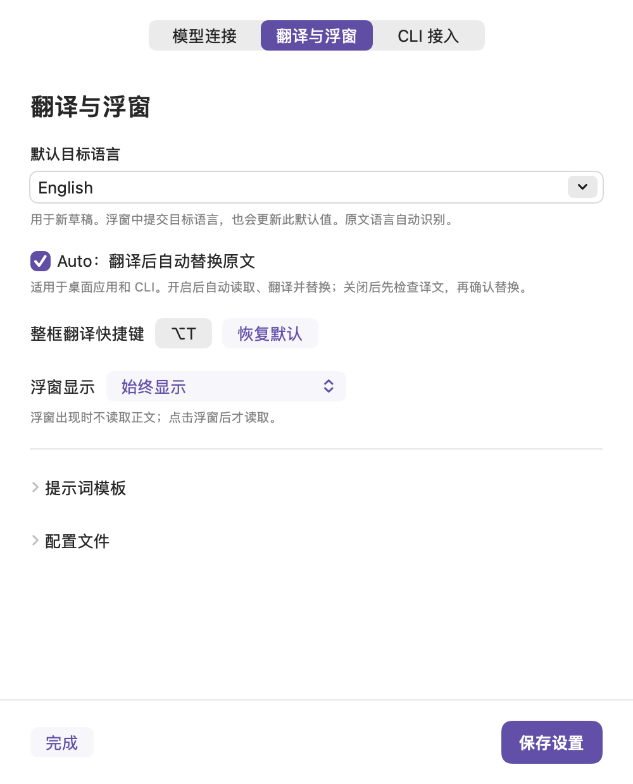
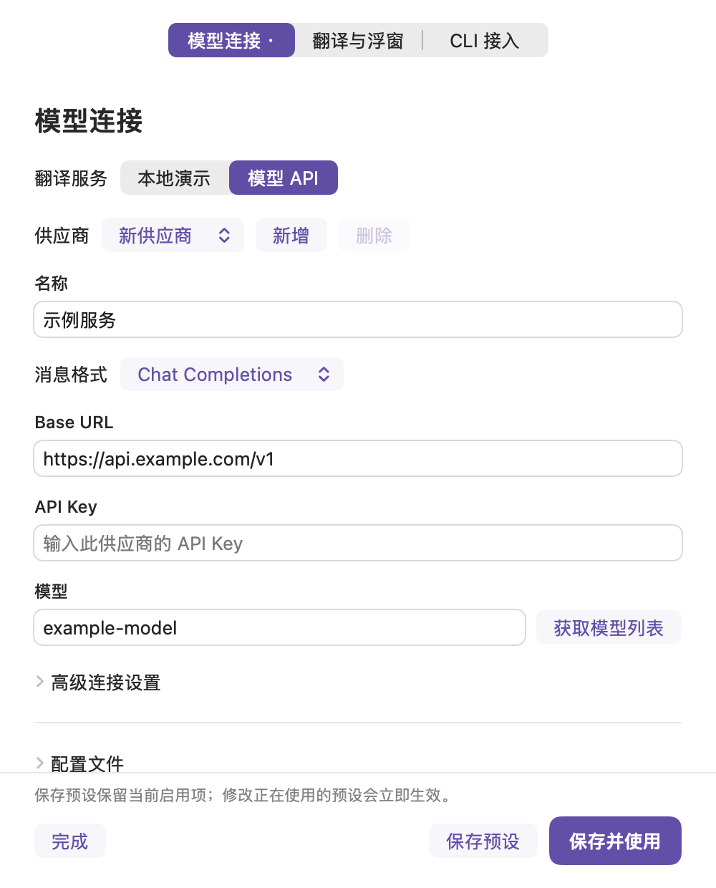

# PromptBridge

在聊天输入框里写好中文，按 **⌥T**，PromptBridge 就会把整份草稿翻译成目标语言，填回原处。什么时候发送，仍由你决定。

这款 macOS 原生工具也支持 Claude Code 和 Codex CLI。想先斟酌措辞，可以关闭 Auto，在浮窗里对照原文编辑译文；临时翻译一段文字，可以直接粘贴到浮窗，完成后复制。

<picture>
  <source media="(prefers-color-scheme: dark)" srcset="docs/images/translation-dark.png">
  
</picture>

## 下载与开始使用

需要 **macOS 14+、Apple Silicon**。

1. 从 [GitHub Releases](https://github.com/d874284271-commits/PromptBridge/releases) 下载应用 ZIP 并解压。
2. 打开 PromptBridge，在“设置 → 模型连接”填写服务地址、API Key 与模型，点击“保存并使用”。
3. 使用其他应用的输入框时，在“设置 → 翻译与浮窗 → 输入框接入”点击“安装并启用”，再授予辅助功能权限。直接输入不需要此权限。
4. 在要翻译的输入框中写好内容，按 **⌥T** 或点击浮窗，即可翻译并替换原文。

下载版使用自签名证书，**未经 Apple 公证**。首次打开可能被 macOS 拦截，请按照[安装说明](docs/installation.md)在系统设置中允许打开；无需关闭系统安全保护。

## 换成顺手的快捷键

在「设置 → 翻译与浮窗」点击当前键位，按下新组合，再点「保存设置」。新键立即生效，重启后仍可用。按 Esc 可以取消这次录入，点击「恢复默认」并保存可切回 ⌥T。

## 日常使用

- **翻译或优化表达**：保留原意翻译，也可以同时调整措辞，让表达更清晰、自然。
- **Auto 开启（默认）**：一键翻译，并自动替换输入框中的原文。
- **Auto 关闭**：先预览、编辑译文，再点击“确认替换”。
- **直接输入**：在浮窗中输入或粘贴文字，翻译后复制使用。
- **恢复原文**：在仍可核对原目标的情况下，恢复最近一次替换。
- **长稿**：原文和译文各自随内容增高，到上限后在各自区域滚动。
- **已有草稿**：更多菜单仅列出实际保存的草稿；草稿与替换记录保留在本次进程内，退出后清空。

在“设置 → CLI 接入”中启用 Claude Code 或 Codex，再新开一个 Terminal 会话，照常启动 CLI 即可使用。详细步骤见[安装与使用](docs/installation.md)。

## 模型连接

连接你自己的模型服务，填写服务地址、API Key 和模型名称即可开始使用。支持 OpenAI Chat Completions、Responses 和 Anthropic Messages 格式及兼容服务。

下图用示例服务演示配置项；填写时请使用供应商提供的地址和模型名。

模型调用费用按所选服务的规则计收。API Key 保存在本机；数据使用与权限说明见[隐私说明](docs/privacy.md)。

## 支持与反馈

部分应用的输入框可能无法直接读取或替换，此时可以在浮窗中粘贴原文，翻译后复制使用。当前版本的验证范围见[版本记录](docs/releases/0.9.2.md)。

- [安装与常见问题](docs/installation.md)
- [源码构建与测试](docs/development.md)
- [架构与接入原则](docs/architecture.md)
- [贡献说明](CONTRIBUTING.md) · [安全报告](SECURITY.md) · [变更记录](CHANGELOG.md)
- [首次公开发布计划](docs/plans/2026-11-08-public-release.md)

## 许可

[Apache-2.0](LICENSE)。图标和第三方声明见 [NOTICE](NOTICE)。
